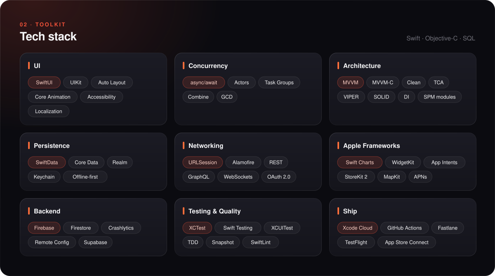
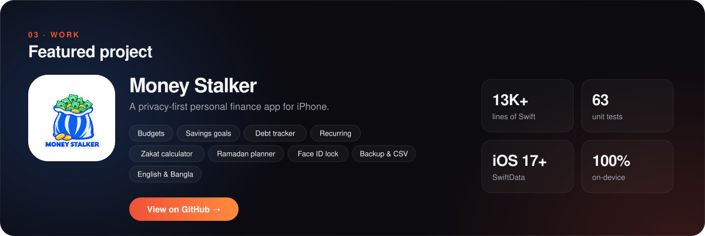

  
  
  
  

 

  

  

  

  

 

  <a href="https://www.linkedin.com/in/ramimstar/">LinkedIn</a> &nbsp;·&nbsp;
  <a href="https://developer-ramim.info/">Portfolio</a> &nbsp;·&nbsp;
  <a href="https://github.com/ramimstar/MoneyStalker">Money Stalker</a>

