<!-- ================= HEADER ================= -->
<p align="center">
  
</p>

<p align="center">
  <a href="https://developer-ramim.info/">
    
  </a>
</p>

<p align="center">
  <a href="https://developer-ramim.info/"></a>
  <a href="https://www.linkedin.com/in/ramimstar/"></a>
  <a href="https://youtube.com/@ramimstar"></a>
  <a href="https://www.instagram.com/ramimstar/"></a>
  
</p>

<br/>

<!-- ================= ABOUT ================= -->
<h2></h2>

<table>
<tr>
<td width="60%" valign="top">

I craft **fast, reliable and beautifully designed apps** for iPhone and iPad.  
I care about the details: buttery-smooth animations, clean architecture, and code that's easy to test and scale.

- 📱&nbsp; Building **[MoneyStalker](https://github.com/ramimstar/MoneyStalker)**, a privacy-first finance app with budgets, goals, debts &amp; Zakat (SwiftUI + SwiftData)  
- 🏗️&nbsp; Focused on **SwiftUI, Swift Concurrency & modular architecture**  
- 🧠&nbsp; Sharpening problem solving with **DSA on NeetCode**  
- 🤝&nbsp; Open to **iOS roles & freelance projects**  
- 📍&nbsp; Dhaka, Bangladesh &nbsp;·&nbsp; 🏠 Working remotely

</td>
<td width="40%" valign="top">

```swift
struct RamimBiswas: iOSDeveloper {
    let role     = "iOS Developer"
    let location = "Dhaka, Bangladesh"
    let focus    = ["SwiftUI", "UIKit",
                    "Concurrency", "Architecture"]
    let mindset  = "Pixel-perfect & user-first"

    func build() async -> App {
        await ship(.appStore)
    }
}
```

</td>
</tr>
</table>

<br/>

<!-- ================= TECH STACK ================= -->
<h2></h2>

<p align="center">
  
</p>

<table align="center">
  <tr>
    <td align="right"><b>🧑‍💻 Languages</b></td>
    <td>Swift · Objective-C · SQL</td>
  </tr>
  <tr>
    <td align="right"><b>🎨 UI</b></td>
    <td>SwiftUI · UIKit (programmatic & Storyboard) · Auto Layout · Core Animation · Custom Components · Accessibility · Localization</td>
  </tr>
  <tr>
    <td align="right"><b>⚡ Concurrency</b></td>
    <td>async/await · Actors · Task Groups · Combine · GCD · OperationQueue</td>
  </tr>
  <tr>
    <td align="right"><b>🏛️ Architecture</b></td>
    <td>MVVM · MVVM-C · VIPER · Clean Architecture · TCA · SOLID · Protocol-Oriented Programming · Dependency Injection · Modularization (SPM)</td>
  </tr>
  <tr>
    <td align="right"><b>💾 Persistence</b></td>
    <td>SwiftData · Core Data · Realm · Keychain · UserDefaults · Offline-first & Sync</td>
  </tr>
  <tr>
    <td align="right"><b>🌐 Networking</b></td>
    <td>URLSession · Alamofire · REST · GraphQL · WebSockets · Codable · JWT / OAuth 2.0 · SSL Pinning</td>
  </tr>
  <tr>
    <td align="right"><b>🍎 Apple Frameworks</b></td>
    <td>MapKit · Core Location · AVFoundation · StoreKit 2 · APNs · WidgetKit · App Intents · HealthKit · Sign in with Apple · Swift Charts</td>
  </tr>
  <tr>
    <td align="right"><b>🔥 Backend</b></td>
    <td>Firebase (Auth, Firestore, Crashlytics, Analytics, Remote Config, FCM) · Supabase</td>
  </tr>
  <tr>
    <td align="right"><b>🧪 Testing</b></td>
    <td>XCTest · Swift Testing · XCUITest · TDD · Mocking · Snapshot Testing · SwiftLint</td>
  </tr>
  <tr>
    <td align="right"><b>🚀 Performance</b></td>
    <td>Instruments (Time Profiler, Allocations, Leaks) · ARC & Memory Management · Launch & Scroll Optimization</td>
  </tr>
  <tr>
    <td align="right"><b>📦 CI/CD & Release</b></td>
    <td>Xcode Cloud · GitHub Actions · Fastlane · TestFlight · App Store Connect · Code Signing</td>
  </tr>
  <tr>
    <td align="right"><b>🛠️ Workflow</b></td>
    <td>Git Flow · PR Reviews · SPM · CocoaPods · Figma · Jira · Agile / Scrum</td>
  </tr>
</table>

<br/>

<!-- ================= FEATURED PROJECTS ================= -->
<h2></h2>

<table>
<tr>
<td width="55%" valign="top">

### 💰 [Money Stalker](https://github.com/ramimstar/MoneyStalker)
A privacy-first personal finance app for iPhone, 100% on-device.

- Budgets, savings goals, debt tracker &amp; recurring transactions
- Islamic Finance Hub: **Zakat calculator**, charity tracker, **Ramadan planner**
- Face ID lock, Keychain, versioned backup &amp; CSV export
- Multi-currency · English &amp; বাংলা · Themes · Swift Charts reports
- Feature-first architecture · **63 unit tests**

<p>


</p>

</td>
<td width="45%" align="center" valign="middle">
  <a href="https://github.com/ramimstar/MoneyStalker"></a>
</td>
</tr>
</table>

<p align="center">
  <a href="https://github.com/ramimstar?tab=repositories"></a>
</p>

<br/>

<!-- ================= GITHUB STATS ================= -->
<h2></h2>

<p align="center">
  <a href="https://github.com/ramimstar?tab=followers"></a>
  <a href="https://github.com/ramimstar/MoneyStalker"></a>
  <a href="https://github.com/ramimstar/MoneyStalker/commits/main"></a>
</p>

<p align="center">
  <picture>
    <source media="(prefers-color-scheme: dark)" srcset="https://streak-stats.demolab.com?user=ramimstar&theme=github-dark-blue&hide_border=true&ring=F05138&fire=F05138&currStreakLabel=F05138" />
    
  </picture>
</p>

<br/>

<!-- ================= FOOTER ================= -->
<p align="center">
  <b>Let's build something great together.</b><br/>
  <a href="https://www.linkedin.com/in/ramimstar/">LinkedIn</a> · <a href="https://developer-ramim.info/">Portfolio</a> · <a href="https://youtube.com/@ramimstar">YouTube</a>
</p>

<p align="center">
  
</p>
